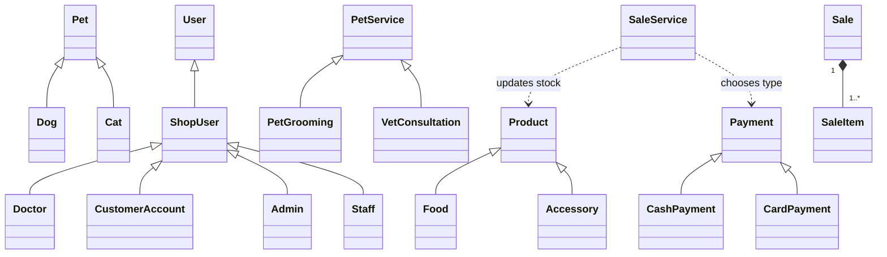

# The Paws Shop — OOP pet shop management system

A web adaptation of the CMIS 2113 proposal. The original proposal describes a desktop app; this version uses a React/Vite website and a Java Spring Boot API, as requested. The frontend and backend are separate folders.

## Requirements

- Java JDK **11 or newer** (verify with `java -version`)
- Apache Maven **3.8+** (`mvn -version`)
- Node.js **18+** and npm (`node -v`, `npm -v`)
- Internet access on the first run to download dependencies.

## Run in Antigravity IDE (or any IDE)

1. Extract the zip and open the **paws-shop** project folder in the IDE.
2. Open a terminal, run:
   ```bash
   cd backend
   mvn spring-boot:run
   ```
   Wait until the log says `Started PawsShopApplication`. The API runs on port **8080**.
3. Open a **second terminal** in the project root:
   ```bash
   cd frontend
   npm install
   npm run dev
   ```
4. Open **http://localhost:5173** in your browser. Click **Staff portal** or navigate to **Services → Book a visit**. Both terminals must remain running. If Vite displays a different port, use the address it prints.

If the IDE terminal opens in a subfolder, navigate back to the project root before `cd backend` or `cd frontend`. If a port is already occupied, stop the other application. For a different API port, change `server.port` in `backend/src/main/resources/application.properties` and the proxy target in `frontend/vite.config.js` together.

## Upgrading an existing copy without losing data

The ZIP intentionally excludes the local H2 database and build/dependency folders. To reuse your previous records, **stop the old backend**, back up its `backend/data` folder, then copy that folder into this version’s `backend/` before starting it. The schema adds nullable columns and a one-time sample-data migration; no automatic migration of legacy customer records to customer logins is attempted. Test your backup first and do not delete the data folder unless you intend to reset everything.

## Demo accounts

| Role | Username | Password | Access |
|---|---|---|---|
| Admin | `admin` | `admin123` | All shop functions and team management |
| Staff | `staff` | `staff123` | Pets, customers, products, sales and appointments; no team management |
| Doctor | `doctor` | `doctor123` | Assigned consultations, pet notes and appointment status |
| Customer | `customer` | `customer123` | Own pets, service requests and appointment history |

Passwords are BCrypt-hashed in the database. These are **demonstration credentials**, not production credentials. The app uses HTTP Basic authentication, stores the current credential in browser session storage and disables CSRF protection for this local demo. Do not deploy it publicly or use real customer/payment data without proper security hardening, HTTPS, safer session handling, CSRF protection, validation and a credential-change mechanism. An admin can create and edit accounts for all four roles via Team. Deleting your own account is prevented.

## User guide

- The public page contains a scrolling story, bento cards, and a pointer-responsive Three.js paw. The redesign supports reduced-motion, reduced-transparency, and increased-contrast preferences.
- Sign in and use the left navigation. Use **Add**, **Edit**, **Delete**, and the search field in the corresponding modules. The pet and product category cannot be changed while editing because it represents the entity's Java subclass; create a replacement instead.
- **Customer dashboard**: add/edit/delete your pets and request grooming or veterinary services. Veterinary bookings require a doctor. Appointments begin as PENDING; the doctor can confirm or complete assigned consultations and update notes. Customers can cancel pending or confirmed appointments. Availability and double-booking are not automatically checked.
- **Admin workspace**: use Team to manage accounts and doctors, Services to manage packages, Appointments to review all bookings, and Inquiries to resolve or delete contact messages. The previous staff workspace remains available. Status changes follow PENDING → CONFIRMED → COMPLETED; PENDING or CONFIRMED may be cancelled. Legacy BOOKED records remain supported. Names are snapshots and do not automatically update when a pet or customer is renamed.
- **Sales & billing → New sale**: choose products and quantities, customer and payment method. Complete the sale to create a receipt and automatically reduce inventory. The bill can be printed. The backend computes prices and total; it rejects insufficient stock. Card is a **record only**, not a real payment gateway.
- The overview displays totals, low stock (5 or fewer units), active appointments and total recorded sales. Search filters loaded records in the browser.
- Data is stored in a persistent local H2 file at `backend/data/pawsshop.mv.db` when started from `backend`. Initial legacy data is seeded when the user table is empty; the additional accounts, packages and catalog use a one-time migration marker. The migration does not overwrite existing records. Back up the data folder before upgrading. To reset everything, stop the backend and delete the `backend/data` folder, then restart it. Do not delete it if you want to retain records.

## Architecture and OOP

```text
frontend/  React + Vite (Node.js tooling), Three.js, CSS
backend/   Spring Boot REST API, Spring Security, Spring Data JPA, H2
```

- **Encapsulation:** entity fields are private with public getters/setters. `Product.removeStock()` enforces the stock invariant.
- **Abstraction:** abstract `User`, `Pet`, `Product`, `PetService`, `ShopUser`, and `Payment` define shared structures or behaviour.
- **Inheritance:** `Dog` and `Cat` extend `Pet`; `Food` and `Accessory` extend `Product`; `Admin`, `Staff`, `Doctor`, and `CustomerAccount` extend `ShopUser` (which extends the mapped superclass `User`); `PetGrooming` and `VetConsultation` extend `PetService`; `CashPayment` and `CardPayment` extend `Payment`. JPA uses single-table inheritance for persisted hierarchies.
- **Polymorphism:** each pet implements `getDisplayInfo()`, each product implements `getCategoryLabel()`, and payment subclasses implement `describe()` differently. `SaleService` works with the abstract `Product` and `Payment` types.
- **Composition:** a `Sale` owns `SaleItem` records; items snapshot the name, price and quantity at the time of sale so a later product edit does not change a historical receipt.
- **Transactions:** `SaleService` uses a transaction and pessimistic product locks in ID order. A failed sale rolls back all stock changes.

Simplified class diagram (Mermaid):



## API and tests

Public endpoints are GET `/api/catalog`, `/api/services`, `/api/doctors` and POST `/api/messages`. All other API endpoints require Basic authentication. Existing `/api/pets`, `/api/customers`, `/api/products`, `/api/appointments`, `/api/sales` and `/api/summary` are restricted to ADMIN and STAFF. `/api/users`, message management and `/api/admin/**` are ADMIN-only; `/api/doctor/**` and `/api/customer/**` require their respective roles and scope records to the authenticated account. `/api/me` is available to all authenticated roles. For example, from another terminal:

```bash
curl -u admin:admin123 http://localhost:8080/api/summary
```

Run the backend unit tests with `cd backend && mvn test`; build the frontend with `cd frontend && npm run build`.

## Scope and limitations

This is a university demonstration, not a production-ready system. It covers the central management workflows in the proposal but does not include a real payment processor, self-service password reset, deployment setup, conflict-free scheduling, real medical advice, or a full standalone project report/use-case diagram. New customer bookings store owner, pet, service and doctor IDs alongside name snapshots; legacy records are not automatically linked. A separate `CustomerAccount` login subtype preserves the existing `Customer` record/table; see `UPGRADE-AUDIT.md`. New catalog prices are placeholders. Contact inquiries are stored locally and no email notifications are sent. Currency is displayed as Sri Lankan rupees (Rs.). Demo content and imagery are illustrative.

## Frontend redesign

The visual redesign uses the `apple-design` skill from Emil Kowalski’s skills repository, installed in `.agents/skills/apple-design/`. `DESIGN-NOTES.md` records the design constraints and focused changes derived from the supplied frontend design guide. The guide is a process guide rather than a pixel-exact pet-shop reference.
